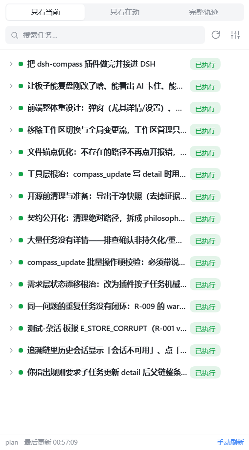
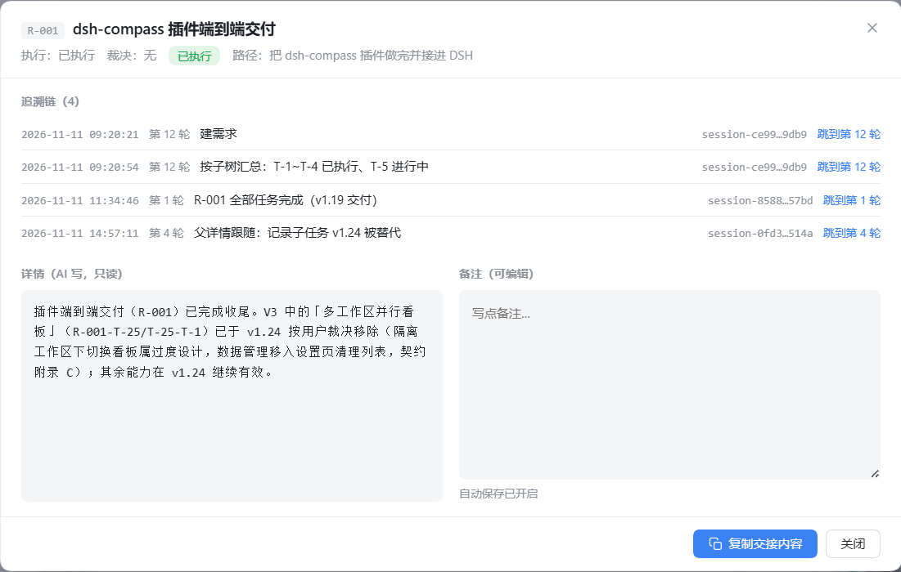

# dsh-taskbearing

[中文](README.md) | **English**

**A workspace-scoped task memory & context-recovery plugin for DSH (DeepSeek Harness).**
It stores the agent's task tree, dual status lines, verbatim user-original baseline and traceability per workspace, and gives you a readable, auditable, handoff-ready task board in the right sidebar.

> 这是本仓库 README 的英文版；中文版见 [README.md](README.md)（正文数据与接口契约见 `docs/`，目前为中文）。

---

## What it solves

- **Loss of direction**: after dozens of turns, nobody remembers the original goal or how far you got.
- **Unreadable status**: the agent's progress notes are full of function names; humans can't scan them.
- **Broken handoff**: a new session can't pick up sub-step-level progress.
- **Paths/facts by memory**: agents invent file paths in detail notes — this plugin refuses such writes at the tool layer (see below).

Design principle: **judgement stays with the AI; the plugin only enforces format, completeness and factual checks** (it does not decide "done or not / covered or not / conflicting or not").

## Features

- **Requirement tree**: requirement → task → step, organized by ownership, with mid-order insertion (`after`/`before`) and re-parenting.
- **Dual status lines**: execution line (not started / in progress / blocked / done) + verdict line (needs ruling / conflict / abandoned / superseded).
- **Verbatim user-original baseline**: the requirement's original words must match the session message **verbatim** (current session: the AI passes `original_text` and the plugin verifies it character by character; cross-session: the plugin reads it back from the session log), with version appending.
- **Traceability**: every change records session / time / turn / note; the detail panel can jump back to the original session and highlight the original turn.
- **Sidebar task board**: three views (current only / active only / full history), pinned rulings, detail & notes (auto-save), one-click handoff copy.
- **Cross-session collision hint**: a tiny marker when another session touched the task within the last 30 minutes (historical changes are not flagged).
- **File anchors**: file paths in notes become clickable anchors; existence is checked first — **missing paths are dimmed and copy-on-click instead of throwing "file not found"**.
- **Path hard check on detail writes**: before writing a detail note the plugin runs `fs.existsSync()` on every recognized path; **any missing path rejects the whole write** with remediation guidance ("verify the real tree, use real paths, never invent paths"). The tri-state UI only covers historical data.
- **Three completion gates**: marking a task done requires a completion note (build-type vs research-type standards, three sections, one per line); a requirement aggregated to "done" requires a requirement summary first (acceptance scope / conclusion / remaining risks); writing any detail requires updating the **entire ancestor chain** (parent task, grandparent, requirement) in the same call — missing one rejects the whole write.
- **Trustworthy turns & traceability**: turn comes from three sources — host `turn/start` event → current session log → empty; **it never guesses from message counts**. Before jumping, the plugin verifies the turn against the session log (legacy wrong turns are restored from the authoritative `at` timestamp); subagent sessions jump to the corresponding turn of the **parent session**.
- **Session availability verification**: historical sessions missing from the client session list are verified via the session log (no more false "session unavailable").
- **Health self-check**: `compass_status.health` mechanically reports suspected duplicate tasks, executed nodes without details, and stale parent chains (child detail newer than its ancestors).
- **Lifecycle management**: the settings dialog lists all local board data, detects orphaned original paths (project moved/deleted) and allows manual cleanup; it is **not a workspace switcher**.
- **Local-first data**: everything lives in `$DSH_HOME/storages/compass/<workspace-name>-<hash>/`; no network upload.

## Screenshots

| Sidebar task board (current only) | Node detail: traceability + detail / notes |
|---|---|
|  |  |

> Screenshots come from a real DSH session (local data, unrelated context removed). "Jump to turn N" in the traceability chain verifies the turn against the session log before locating it.

## Requirements

- Node.js **≥ 22.15** (session-log decoding uses Node built-in zstd; the plugin runs inside the DSH process, so the DSH-bundled runtime governs in practice)
- DSH (DeepSeek Harness) **0.2.x** (host/client facet and right-sidebar tab system)

## Install

The plugin consists of a host facet and a client facet, loaded as a plugin of a DSH profile.

1. Put the package into the DSH profile you use (either way):
   ```bash
   cd "$DSH_HOME/profiles/<profile>"
   # option 1: install from npm (published version)
   npm install dsh-taskbearing
   # option 2: install straight from GitHub (available now, tracks main)
   npm install github:wangshouyong/dsh-taskbearing
   # option 3: download the GitHub Release tarball and install locally
   #   https://github.com/wangshouyong/dsh-taskbearing/releases
   npm install ./dsh-taskbearing-0.1.0.tgz
   # or link locally during development (Windows junction / Unix symlink)
   #   <profile>/node_modules/dsh-taskbearing -> path to this repo
   ```
2. Register the plugin in the profile's `cordis.patch.yml`:
   ```yaml
   - insert:
       - id: dsh-taskbearing
         name: 'dsh-taskbearing'
   ```
3. Restart DSH. Open any session's right sidebar → the "Task board" card.

On first use, ask the AI to call `compass_init`: it initializes the workspace data directory and writes the usage rules into the marked block of `$DSH_HOME/AGENTS.md` (effective for new sessions).

> Development: after changing the client facet run `npm run build:client` to regenerate `lib/client.js`, then refresh the page (host facet changes need a DSH restart).

## Quick start

```
compass_init                                  # init workspace + install global rules
compass_require  (title/human_line/surface)   # create the first requirement (original text from current session by default)
compass_plan     (parent_id/title/human_line) # break down tasks (after/before supported)
compass_update   (task_ids/exec_state/pointer_note)  # advance status
```

From then on, before finishing each turn the AI self-checks against the rules in `$DSH_HOME/AGENTS.md` and records progress via `compass_update` / `compass_plan`; the UI polls every 2 seconds.

## Tools

| Tool | Purpose |
|---|---|
| `compass_init` | Initialize workspace data + install/upgrade the global rules block (idempotent) |
| `compass_require` | Create a requirement + baseline v1 (`original_text`: current-session original, verified verbatim) |
| `compass_plan` | Create a task node (supports `after`/`before`) |
| `compass_update` | Patch-style batch update of status/verdict/detail (path hard check before detail writes) |
| `compass_read` | Read-only: `tree` / `tree-lite` / `detail:<id>` / `baseline` |
| `compass_change` | Requirement change: append a baseline version (same original-text rules as require) |
| `compass_merge` | Mark a merge relationship (no node moving, no data deletion) |
| `compass_move` | Re-parent a node (same ID, cycle-safe) |
| `compass_import` | History backfill (preview/apply; only for new-session recovery or cross-session repair, see rules) |
| `compass_status` | Read-only self-check: board freshness counters + health (duplicates / missing details / stale chains) |
| `compass_migrate` | Migrate a legacy `status.md` (preview/apply) |

## Panel

- **Three views**: current only / active only / full history; requirement rows show mechanical child-task counts.
- **Detail dialog**: AI detail (read-only) | user notes (auto-save) | traceability (jump to session/turn) | file anchors.
- **Settings dialog**: preferences / diagnostics / migration & backup (export/import) / local board data cleanup / uninstall.
- Light/dark theme follows the host; narrow panels (≤340px) reflow, long text truncates or wraps, never scrolls horizontally.

## Development

```bash
npm install          # devDependency: vite (only needed to build the client)
node --test          # full unit test suite (currently 251 tests)
npm run build:client # build the client facet → lib/client.js
```

Layout:

```
src/core/    host-agnostic core (storage / validation / state machine / baseline / path recognition & checks)
src/host/    DSH host integration (tool registration / routes / rules block / session & turn)
src/client/  right-sidebar panel (React + plain CSS)
lib/         build artifacts (client.js loaded by DSH)
test/        node --test unit tests
docs/        design docs (philosophy / schema-v2 / ui-design)
```

## Docs

- [Design philosophy & user guide](docs/philosophy.md) (中文) | [English](docs/philosophy.en.md) — business rules, state machine, glossary
- [Data & API contract schema-v2](docs/schema-v2.md) (中文) | [English](docs/schema-v2.en.md) — JSON structures, fields, tool APIs, error codes
- [UI implementation notes](docs/ui-design.md) (Chinese only, historical design doc)

## Known limitations

- File-path recognition requires an **extension whitelist** and no spaces/CJK characters (e.g. `dsh-compass 技术方案 v1.25.md` gets truncated) — an existing boundary of the `file-anchor` layer.
- The detail hard check applies to new writes of `compass_plan` / `compass_update`; `compass_import` (other workspace data) and `compass_migrate` (historical document text) are exempt.
- Turn-based navigation depends on session logs (`$DSH_HOME/sessions`); without a persisted log only "open the original session" works and the plugin says so explicitly instead of inventing a turn.
- The ancestor-chain gate applies to "write detail / mark done"; plain status transitions (not started → in progress) are not blocked — stale parent chains are surfaced by `compass_status.health.stale_chains`.
- `compass_migrate` and whole-board bundle restore are exempt from the ancestor gate; `compass_import` nodes marked "done" must carry a qualified completion note.
- Requires DSH host APIs (tool registration, right-sidebar tab, webServer routes); the UI cannot run in a standalone Node process.
- CI runs unit tests on **Windows and Linux** (node 22/24); the client-facet build and docs-mirror checks run on Linux — the same platform as the npm publish workflow, so platform differences cannot silently block the publish gate.
- Task quality depends on the AI following the rules; the plugin only does mechanical checks, not semantic judgement.

## Contributing

See [CONTRIBUTING.md](CONTRIBUTING.md). Run `node --test` before submitting and follow "change the contract first, then the code".

## License

MIT License. See [LICENSE](LICENSE).
