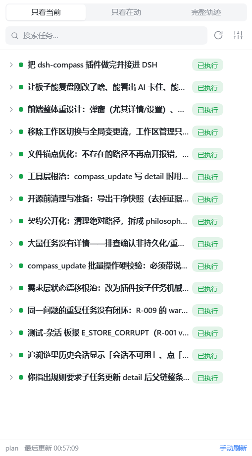
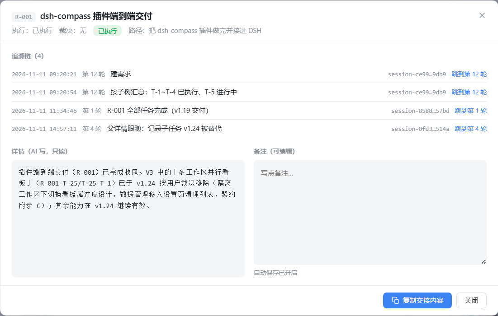

# dsh-taskbearing

**中文** | [English](README.en.md)

**DSH（DeepSeek Harness）工作区级任务记忆与方向恢复插件。**
把 AI 的任务树、双线状态、逐字原话基线和追溯链按工作区存下来，在右侧栏给你一个可读、可追溯、可交接的任务板。

> A workspace-scoped task memory & context-recovery plugin for DeepSeek Harness (DSH):
> requirement tree, dual status lines, verbatim user-original baseline, traceability, and a sidebar task board.

---

## 它解决什么

- **方向感丢失**：聊了几十轮，忘了最初要什么、现在做到哪。
- **状态不可读**：AI 写的进度满是函数名，人看不懂。
- **切换会话断档**：新会话接不上子步骤级进度。
- **路径/事实靠记忆**：AI 在详情里编造文件路径——本插件在工具层直接拒写（见下）。

设计原则：**判断权归 AI，插件只做格式、完整性与事实性校验**（不判断"做完没有/覆盖没有/是否冲突"）。

## 特性

- **需求树**：需求 → 任务 → 步骤，层级按从属关系组织，支持中间插入（`after`/`before`）与换父。
- **双线状态**：执行线（未开始 / 进行中 / 已阻塞 / 已执行）+ 裁决线（待裁决 / 冲突 / 已废弃 / 已替代）。
- **逐字原话基线**：需求原话与会话消息**逐字一致**（当前会话可由 AI 传入 `original_text`，插件逐字校验；跨会话由插件从会话日志取回），支持版本追加。
- **追溯链**：每次变更记录会话 / 时间 / 轮次 / 说明，详情内可跳回原会话、定位到原轮次并高亮。
- **右侧栏任务板**：三视图（只看当前 / 只看在动 / 完整轨迹）、待裁决钉顶、详情与备注（备注自动保存）、一键复制交接内容。
- **跨会话撞车提示**：任务在最近 30 分钟被另一个会话操作时，行上给极小提示（不误报历史变更）。
- **文件锚点**：详情/备注中的文件路径变成可点击锚点；打开详情时先做存在性检测——**不存在的路径弱化显示、点击复制，不再点开报错**。
- **detail 路径强校验**：AI 写详情前，插件用 `fs.existsSync()` 校验其中所有文件路径；**任一不存在直接拒绝写入**，并返回「核实真实文件结构、使用真实路径、严禁捏造」的整改指引。三态 UI 只作为历史数据兜底。
- **完成说明三闸门**：标记「已执行」必须写完成说明（修改/构建型与查询/调研型两套标准，三段须各起一行）；需求被机械聚合为「已执行」前必须先有需求完成汇总（验收范围 / 完成结论 / 遗留风险）；写任何详情必须同时更新**整条祖先链**（父任务、父级的父级、需求），缺一项直接拒绝、整次不落盘。
- **轮次与追溯可信**：轮次来源三级——宿主 `turn/start` 事件 → 会话日志还原 → 留空，**绝不按消息条数猜**；点击追溯记录前用会话日志核验轮次（旧数据写错的轮次按 `at` 还原），子代理会话自动跳到**父会话**对应轮次。
- **会话可用性核验**：客户端会话列表看不到的历史会话，按会话日志存在性核验（不再误报「会话不可用」）。
- **健康自检**：`compass_status.health` 机械暴露疑似重复任务、已执行但没有详情、父链陈旧（子节点详情比祖先新）。
- **生命周期管理**：设置页列出本机全部任务板数据，检测原始路径已失效（项目被删/移动），支持手动清理；**不是看板切换器**。
- **数据本地化**：全部数据存 `$DSH_HOME/storages/compass/<工作区名>-<hash>/`，无网络上报。

## 截图

| 右侧栏任务板（只看当前） | 节点详情：追溯链 + 详情 / 备注 |
|---|---|
|  |  |

> 截图来自真实 DSH 会话（本地数据，已隐去与任务无关的上下文）。追溯链里的「跳到第 N 轮」会先按会话日志核验轮次再定位。

## 环境要求

- Node.js **≥ 22.15**（会话日志解码使用 Node 内置 zstd；插件运行在 DSH 进程内，实际以 DSH 自带运行时为准）
- DSH（DeepSeek Harness）**0.2.x**（host/client facet 与右侧栏 tab 体系）

## 安装

本插件由 host facet + client facet 组成，作为 DSH profile 的一个插件加载。

1. 把包装进你使用的 DSH profile（任选其一）：
   ```bash
   # 从 npm 安装（推荐；以 registry 上已发布的版本为准）
   cd "$DSH_HOME/profiles/<profile>"
   npm install dsh-taskbearing
   # 或直接从 GitHub 安装（想追主干/尚未发布时）
   npm install github:wangshouyong/dsh-taskbearing
   # 或开发期本地链接（Windows junction / Unix symlink）
   #   <profile>/node_modules/dsh-taskbearing -> 本仓库路径
   ```
2. 在 profile 的 `cordis.patch.yml` 中注册插件：
   ```yaml
   - insert:
       - id: dsh-taskbearing
         name: 'dsh-taskbearing'
   ```
3. 重启 DSH。打开任意会话右侧边栏 →「任务板」卡片。

首次使用让 AI 调用 `compass_init`：初始化当前工作区数据目录，并把使用规则写入 `$DSH_HOME/AGENTS.md` 的标记区块（新会话生效）。

> 开发调试：client facet 修改后运行 `npm run build:client` 重新生成 `lib/client.js`，刷新页面即可（host facet 修改需重启 DSH）。

## 快速开始

```
compass_init                                  # 初始化工作区 + 安装全局规则
compass_require  (title/human_line/surface)   # 落第一条需求（默认从当前会话取原话）
compass_plan     (parent_id/title/human_line) # 拆任务（可 after/before 定位）
compass_update   (task_ids/exec_state/pointer_note)  # 推进状态
```

之后每轮结束前，AI 按 `$DSH_HOME/AGENTS.md` 的规则自查并用 `compass_update/compass_plan` 落板；UI 2 秒轮询自动刷新。

## 工具一览

| 工具 | 作用 |
|---|---|
| `compass_init` | 初始化工作区数据 + 安装/升级全局规则区块（幂等） |
| `compass_require` | 新建需求 + 基线 v1（`original_text` 当前会话原话，插件逐字校验） |
| `compass_plan` | 建任务节点（支持 `after`/`before` 中间插入） |
| `compass_update` | patch 语义批量更新状态/裁决/详情（写 detail 前做路径强校验） |
| `compass_read` | 只读：`tree` / `tree-lite` / `detail:<id>` / `baseline` |
| `compass_change` | 需求变更：追加基线版本（原话规则同 require） |
| `compass_merge` | 标记合并关系（不挪节点、不删数据） |
| `compass_move` | 换父节点（ID 不变、防环） |
| `compass_import` | 历史回填（preview/apply，仅用于新会话溯源或跨会话修复，见规则） |
| `compass_status` | 只读自查：板面新鲜度机械计数（轮次/工具调用） |
| `compass_migrate` | 旧 `status.md` 迁移（preview/apply） |

## 面板

- **三视图**：只看当前 / 只看在动 / 完整轨迹；需求行显示子任务机械计数。
- **详情弹窗**：AI 详情（只读）｜用户备注（自动保存）｜追溯链（可跳原会话/原轮次）｜文件锚点。
- **设置弹窗**：偏好 / 诊断 / 迁移与备份（导出/导入）/ 本机任务板数据清理 / 卸载。
- 明暗主题跟随宿主；窄面板（≤340px）自动重排，长文本省略或换行，不横向滚动。

## 开发

```bash
npm install          # 仅构建 client 需要 devDependency: vite
node --test          # 全部单元测试（当前 251 个）
npm run build:client # 构建 client facet → lib/client.js
```

目录结构：

```
src/core/    宿主无关核心层（存储 / 校验 / 状态机 / 基线 / 路径识别与校验）
src/host/    DSH 宿主接入（工具注册 / 路由 / 规则区块 / 会话与轮次）
src/client/  右侧栏面板（React + 原生 CSS）
lib/         构建产物（client.js 供 DSH 加载）
test/        node --test 单元测试
docs/        设计文档（philosophy / schema-v2 / ui-design）
```

## 文档

- [设计哲学与使用指南](docs/philosophy.md)（中文）｜[English](docs/philosophy.en.md)（面向用户/开发者：业务规则、状态机、术语表）
- [数据与接口契约 schema-v2](docs/schema-v2.md)（中文）｜[English](docs/schema-v2.en.md)（面向二次开发：JSON 结构、字段、工具 API、错误码）
- [UI 实现细则](docs/ui-design.md)（历史设计文档，仅中文）

## 已知限制

- 文件路径识别要求**扩展名白名单**且不含空格/中文（如 `dsh-compass 技术方案 v1.25.md` 会被截断）——这是 `file-anchor` 识别层的既有边界。
- detail 强校验只作用于 `compass_plan` / `compass_update` 的新写入；`compass_import`（别的工作区数据）与 `compass_migrate`（历史文档原文）不校验。
- 需要 DSH 宿主 API（工具注册、右侧栏 tab、webServer 路由）；独立 Node 进程无法运行 UI。
- 追溯跳转依赖会话日志（`$DSH_HOME/sessions`）：会话没有持久化日志时只能「打开原会话」，无法核验轮次（会显式提示，不猜）。
- 祖先链硬校验作用于「写详情 / 标记已执行」；纯状态推进（未开始 → 进行中）不阻断，父链是否陈旧由 `compass_status.health.stale_chains` 机械暴露。
- `compass_migrate`（历史文档）与整板 bundle 恢复豁免祖先链校验；`compass_import` 回填「已执行」节点必须自带合格完成说明。
- CI 只在主平台 **Windows** 上跑单测（POSIX 可运行但未做全平台回归）；构建 client facet 的 job 在 Linux 上跑。
- 任务质量取决于 AI 是否按规则维护；插件只做机械校验，不做语义判断。

## 贡献

见 [CONTRIBUTING.md](CONTRIBUTING.md)。提交前请跑 `node --test`，并遵守「先改契约、再改代码」。

## License

MIT License。见 [LICENSE](LICENSE)。
